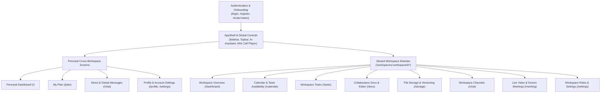

# SyncTayo — Complete Screen & Feature Guide

This guide explains **every screen, workspace module, and supporting feature** inside SyncTayo. For each screen, you will find:
1. **What It Is For** — The core purpose of the screen.
2. **What Can Be Done With It** — Every action and tool available on the screen.
3. **How to Use It for Maximum Coordination & Efficiency** — Practical workflows that keep teams aligned and prevent bottlenecks.
4. **Supporting Features** — Built-in safeguards, shortcuts, and enhancements.

---

## Quick Navigation Map

---

## Part 1: Authentication & Team Onboarding Screens

### 1. Login, Registration & Password Recovery (`/login`, `/register`, `/forgot-password`, `/reset-password`)
- **What It Is For:** Securely signing in, creating a new SyncTayo account, or recovering access via email reset tokens.
- **What Can Be Done With It:**
  - Sign in with email and password or Google OAuth.
  - Register a new user account with instant profile creation.
  - Request a password reset link and set a new password securely.
- **How to Use It for Efficiency:** Use Google Single Sign-On (SSO) to onboard teammates in seconds without password fatigue.

### 2. Workspace Invitation Acceptance (`/invite/:token`)
- **What It Is For:** Joining a team workspace via a shared email link or invite token.
- **What Can Be Done With It:**
  - View the workspace name, inviter details, and assigned role before accepting.
  - Accept the invitation whether already signed in or right after creating an account.
- **How to Use It for Coordination:** Share invite links with new project members so they land directly inside the right workspace with their role and permissions pre-configured.

---

## Part 2: Personal Cross-Workspace Screens

### 3. Personal Dashboard (`/`)
- **What It Is For:** A unified command center that aggregates your tasks, upcoming meetings, schedule conflicts, and workspace shortcuts across **all** workspaces you belong to.
- **What Can Be Done With It:**
  - **Graphical Task Summary:** View a visual priority distribution bar (*Urgent*, *High*, *Medium*, *Low*) and an *Overdue vs. On-track* breakdown of your open tasks.
  - **Schedule Conflicts Panel:** See real-time warnings for **Event Overlaps**, **Deadline Clashes**, and **Task vs. Event Overlaps**.
  - **1-Click Conflict Resolution:** Expand any conflict card to see verified conflict-free alternative time slots, meeting priority guidance, and recommended task completion order. Click **Apply** to reschedule an event or **Shift due date (+1d)** to resolve task clashes immediately.
  - **Upcoming Schedule & Workspaces:** Jump straight into today's meetings or open any workspace card.
  - **Customizable Dashboard Layout:** Click **Customize** to show, hide, resize, or reorder widgets (such as *Recent Activity* and *Recent Files*, which are hidden by default to keep the screen clean).
- **How to Use It for Coordination & Efficiency:**
  - Start every morning on the Personal Dashboard. Check the **Conflicts Panel** first—resolving overlapping meetings or deadline pileups with 1-click suggestions prevents missed deliverables later in the week.

---

### 4. My Plan (`/plan`)
- **What It Is For:** Your personal daily execution planner that turns your cross-workspace deadlines and calendar events into a structured, time-blocked daily agenda.
- **What Can Be Done With It:**
  - **Daily Time-Block Timeline:** See how your open tasks fit around your scheduled meetings for the selected day.
  - **Direct Task Creation (`+ New task`):** Create a task directly from My Plan and assign it to any of your workspaces without leaving your daily schedule.
  - **Direct Task Editing:** Click any scheduled task block or priority item to edit its title, due date, priority, status, or subtasks inline.
  - **Declutter Mode Toggle:** Switch between **Declutter** (clean timeline + top priorities only) and **Detailed guidance** (full coaching tips, workload breakdown, and scheduling rationale).
- **How to Use It for Coordination & Efficiency:**
  - Use **Declutter** mode during deep-work hours so you only see the current task block and your immediate checklist. If a new action item comes up mid-day, click **`+ New task`** right inside My Plan to capture it into the proper workspace immediately.

---

### 5. Direct & Global Messages (`/chat`)
- **What It Is For:** Communicating with teammates across workspaces in one place via Direct Messages (DMs) and workspace channels.
- **What Can Be Done With It:**
  - Start 1-on-1 conversations with any teammate or switch between workspace channels.
  - Send rich text messages, file attachments, voice notes, and inline replies.
  - React to messages with emojis, pin important announcements, or star messages for personal bookmarking.
  - **Seen / Read Receipts:** View single-check (`✓ Sent`) and double-check (`✓✓ Seen` or `✓✓ Seen by Name`) indicators on your sent messages.
- **How to Use It for Coordination & Efficiency:**
  - Check the `✓✓ Seen` indicator after sending urgent handoff instructions so you know with certainty whether your teammate has read the update without needing to send follow-up "Did you see this?" pings.

---

### 6. User Profile & Personal Settings (`/profile`, `/settings`)
- **What It Is For:** Managing your personal identity, appearance preferences, notification rules, and security settings.
- **What Can Be Done With It:**
  - Upload or update your avatar, display name, bio, and job title (`/profile`).
  - Toggle Light / Dark / System theme modes (`/settings`).
  - Configure notification preferences (in-app toasts, sound alerts, email digests) and update account security credentials.
- **How to Use It for Efficiency:** Set a clear display name and avatar so teammates can easily identify you in live document cursors, task assignments, and availability timelines.

---

## Part 3: Shared Workspace Screens (`/workspaces/:workspaceId/*`)

### 7. Workspace Overview (`/workspaces/:workspaceId/dashboard`)
- **What It Is For:** A focused health check for a **single project or team workspace**, showing everyone's progress, upcoming team events, and project-specific conflicts.
- **What Can Be Done With It:**
  - Monitor workspace-level pending tasks with visual priority and overdue charts.
  - Spot and resolve workspace-specific schedule conflicts with 1-click slot application.
  - Customize the workspace widget layout independently or optionally expose the **Recent Activity** feed and **Recent Files** widget.
- **How to Use It for Coordination & Efficiency:**
  - Keep this screen open during daily standups to review the team's overdue count, upcoming milestones, and any scheduling collisions affecting the project.

---

### 8. Workspace Tasks (`/workspaces/:workspaceId/tasks`)
- **What It Is For:** End-to-end project task tracking, assignment, prioritization, and progress visualization.
- **What Can Be Done With It:**
  - **Upfront Status Summary Cards:** View three interactive status cards at the top of the screen (**To Do**, **In Progress**, **Completed**) showing live counts and completion percentage bars. Click any card to filter your current view immediately.
  - **4 Switchable Task Views:**
    - **List View:** Structured rows grouped by status for fast scanning and batch triage.
    - **Board View (Kanban):** Drag-and-drop columns (*To Do*, *In Progress*, *Completed*) for visual workflow management.
    - **Calendar View:** Tasks plotted by due date to spot deadline clusters.
    - **Table View:** Spreadsheet-style sortable columns showing assignees, priorities, tags, due dates, and subtask counts.
  - **1-Click Quick-Filter Pills & Advanced Filters:** Filter instantly by *"All Cards"*, *"To do"*, *"In progress"*, *"Completed"*, or *"Assigned to me"*, plus search by keyword, priority, assignee, or tag.
  - **Rich Task Details Panel:** Click any task to manage subtasks/checklists, upload task attachments, post task comments, and update status or priority.
  - **Task Editing Permission Controls:** Only the **task creator**, **assigned members**, or members with the **`tasks.manage`** permission (Owners, Admins, or custom roles) can edit or delete a task. Other members get a read-only view with an explanatory tooltip.
  - **Trash / Bin & Recovery:** Deleted tasks are soft-deleted into the **Trash** modal. Authorized members can restore accidentally deleted tasks with 1 click or permanently purge them.
- **How to Use It for Coordination & Efficiency:**
  - Use **Board View** during team check-ins to move work from *To Do* to *In Progress*.
  - Click the **Assigned to me** pill to focus strictly on your deliverables.
  - Rely on permission locks and the **Trash Bin** so large teams can collaborate without fear of someone accidentally overwriting or losing critical project tasks.

---

### 9. Workspace Calendar & Shared Team Availability (`/workspaces/:workspaceId/calendar`)
- **What It Is For:** Coordinating team meetings, project milestones, and finding conflict-free meeting times across all workspace members.
- **What Can Be Done With It:**
  - **4 Calendar Modes:** Switch between **Month**, **Week**, **Agenda**, and the **Team Availability** view.
  - **Shared Team Availability Timeline (`Team` View):**
    - Inspect a side-by-side visual timeline of every workspace member's busy blocks (events and scheduled tasks) between **08:00 and 20:00** for any selected date.
    - Filter which team members to include in the comparison and select your desired meeting duration (**30 mins**, **45 mins**, **1 hour**, or **1.5 hours**).
  - **Recommended Mutual Free Windows & 1-Click Auto-Schedule:**
    - SyncTayo automatically computes conflict-free windows where all selected teammates are available.
    - Click **`⚡ Auto-Schedule Best Slot`** (or pick any suggested window) to open the Event Modal pre-filled with the optimal date, start time, and end time.
- **How to Use It for Coordination & Efficiency:**
  - Stop asking *"When is everyone free?"* in chat. Switch to the **Team** tab on the Calendar, select the required attendees and meeting duration, and click **Auto-Schedule Best Slot** to book a guaranteed conflict-free meeting in seconds.

---

### 10. Collaborative Documents & Live Editor (`/workspaces/:workspaceId/docs` & `/docs/:docId`)
- **What It Is For:** Creating, editing, and organizing team documentation, meeting notes, specs, and wikis in real time.
- **What Can Be Done With It:**
  - **Document Hub (`/docs`):** Browse all workspace documents, filter by category/tag, view the active **Live Now** editing badge when teammates are inside a doc, or click the **Download (`.md`)** button on any card.
  - **Live Collaborative Editor (`/docs/:docId`):**
    - Co-edit documents in real time powered by Yjs CRDT synchronization—multiple teammates can type simultaneously with live colored cursors and active collaborator avatars in the top bar.
    - Format content with headings, lists, checklists, code blocks, quotes, and tables using the formatting toolbar.
    - Save and inspect **Document Snapshots / Version History** to review or roll back changes.
    - **1-Click Direct Download:** Export any document directly to your device as a clean Markdown (`.md`) file from either the editor toolbar or the document list.
- **How to Use It for Coordination & Efficiency:**
  - Open a shared document during a live workspace meeting so everyone can contribute notes and action items simultaneously. When the spec is finalized, use the **Download** button to export a portable copy for external stakeholders or offline submission.

---

### 11. Workspace File Storage & Versioning (`/workspaces/:workspaceId/storage`)
- **What It Is For:** Centralizing project assets (PDFs, images, spreadsheets, archives, design files) with non-destructive version control and quota management.
- **What Can Be Done With It:**
  - **Upload & Organize Assets:** Drag and drop files, search by filename, filter by file type (Images, Documents, Audio/Video, Archives), and monitor workspace storage usage.
  - **Always-Visible Version Badges (`V1`, `V2+`):** Every file card displays its current version number with an explanatory tooltip.
  - **Version History Drawer & Non-Destructive Restore:**
    - Upload a new version of an existing file without breaking links or losing older drafts.
    - Open the **History** drawer to download any previous version or click **Restore**—which safely promotes the selected historical file to become the newest version (`V(n+1)`) without erasing intermediate versions.
  - **In-App Versioning Guide (`? Versioning Guide`):** Open the interactive step-by-step guide modal at any time to see how uploading, restoring, and version history work.
  - **Storage Trash / Bin:** Soft-delete unneeded files and restore them from the Storage Trash before permanent deletion.
- **How to Use It for Coordination & Efficiency:**
  - Instead of uploading `Final_Report_v2_FINAL_revised.pdf` as separate files, upload new revisions onto the **same** asset card. Everyone always downloads the latest version by default, while older drafts remain safely recoverable in the History drawer.

---

### 12. Workspace Chat Channels (`/workspaces/:workspaceId/chat`)
- **What It Is For:** Organized, topic-based real-time messaging scoped specifically to the current workspace.
- **What Can Be Done With It:**
  - Create and switch between dedicated channels (e.g., `#general`, `#announcements`, `#design`, `#engineering`).
  - Share files, record voice messages, reply in threads, react with emojis, and pin key decisions to the channel header.
  - Track message delivery and team engagement with live **`✓✓ Seen`** read receipts showing which teammates have read the latest messages.
- **How to Use It for Coordination & Efficiency:**
  - Pin sprint goals or key reference links to the top of each workspace channel so new or returning members don't have to scroll through chat history to find critical context.

---

### 13. Workspace Live Meetings (`/workspaces/:workspaceId/meeting`)
- **What It Is For:** Running real-time voice, video, and screen-sharing sessions directly inside the workspace without external meeting links.
- **What Can Be Done With It:**
  - Start or join an active workspace call with camera, microphone, and **Screen Sharing** controls.
  - Use the in-call side panel to chat or take notes while watching a teammate's shared screen.
  - **Floating Mini Call Player:** Navigate away from the Meeting screen to **Tasks**, **Docs**, or **Calendar** while the call stays active in a compact picture-in-picture floating bar at the bottom of your screen.
- **How to Use It for Coordination & Efficiency:**
  - Join the workspace meeting and then switch to the **Tasks** board or a **Collaborative Document**—the **Mini Call Player** keeps your audio/video connected while you update tasks or co-edit notes live with your team.

---

### 14. Workspace Settings, Roles & Permissions (`/workspaces/:workspaceId/settings`)
- **What It Is For:** Managing workspace membership, custom role-based access control (RBAC), invitations, and workspace metadata.
- **What Can Be Done With It:**
  - Invite new members by email and manage pending invitations.
  - Assign built-in roles (**Owner**, **Admin**, **Member**) or create **Custom Roles** with granular permission toggles:
    - `tasks.manage` (edit/delete any workspace task & manage task trash)
    - `calendar.manage` (manage team events)
    - `storage.manage` (manage workspace files and storage trash)
    - `members.manage` & `roles.manage` (administer team access)
  - Update the workspace name, description, or archive/leave the workspace.
- **How to Use It for Coordination & Efficiency:**
  - Grant `tasks.manage` to project leads and coordinators so they can triage and reorganize any task across the board, while keeping standard members scoped to editing only the tasks they created or are assigned to.

---

## Part 4: Global & Supporting Features Available Everywhere

### 15. AI Workspace Assistant & Voice Mode (Floating Launcher / Sidebar Control)
- **What It Is For:** An intelligent, context-aware copilot that can answer questions about your workspace, evaluate workload complexity, and execute real workspace actions via text or voice.
- **What Can Be Done With It:**
  - **Task Creation & Updates:** Ask the AI to create tasks, set priorities, assign teammates, or reschedule deadlines.
  - **Task Difficulty & Complexity Assessment (`assess_task_difficulty`):** Ask *"How difficult are our current tasks?"* or *"Assess the complexity of [Task Name]"*. The AI evaluates subtasks, priority, time remaining, description depth, and dependencies to return a **Difficulty Score (0–100)**, **Level** (*Low / Moderate / High / Critical*), **Estimated Effort Hours**, **Key Risk Factors**, and **Actionable Recommendations** (plus a ranked breakdown across all open workspace tasks).
  - **Workspace Summaries & Prioritization:** Ask for an instant summary of overdue work, upcoming deadlines, or recommended task order.
  - **Action Preview Cards with Explicit Feedback:**
    - Destructive or important changes present an interactive **Confirm / Dismiss** preview card.
    - Completed actions display a **green success banner** with a direct navigation link (e.g., *Open Task*, *View Calendar*).
    - Failed actions display a **red error alert** with a 1-click **Retry** button and a **Dismiss** button.
  - **Hands-Free Voice Mode:** Speak requests naturally and confirm or dismiss proposed actions by voice or click.

### 16. Global Topbar, Real-Time Notifications & Mobile Drawer
- **What It Is For:** Keeping you informed and navigating smoothly across desktop, tablet, and mobile devices.
- **What Can Be Done With It:**
  - **Real-Time Notification Bell & Toasts:** Receive instant alerts when you are assigned a task, mentioned in chat, invited to a workspace, or approaching a deadline.
  - **Responsive Mobile Navigation:** On phones and tablets, the layout adapts edge-to-edge with a slide-over workspace drawer and compact topbar so you can check tasks, reply to messages, or review your plan on the go.

---

## Summary: How SyncTayo Ensures Maximum Team Efficiency

| Workflow Stage | Screen / Feature to Use | Efficiency Outcome |
| :--- | :--- | :--- |
| **1. Morning Triage** | **Personal Dashboard (`/`)** + **My Plan (`/plan`)** | Spot cross-workspace conflicts early, apply 1-click alternative time slots, and focus on a decluttered daily timeline. |
| **2. Sprint & Task Planning** | **Workspace Tasks (`/tasks`)** + **AI Difficulty Assessment** | Filter via upfront status cards (*To Do / In Progress / Completed*), switch between List/Board/Calendar/Table views, and let the AI identify high-risk tasks before they slip. |
| **3. Booking Team Syncs** | **Calendar Team View (`/calendar`)** | View side-by-side member busy timelines and click **Auto-Schedule Best Slot** to book conflict-free meetings without back-and-forth messages. |
| **4. Live Execution** | **Meetings (`/meeting`)** + **Collaborative Docs (`/docs`)** | Talk via the floating Mini Call Player while co-editing specs with live cursors and exporting final `.md` files with 1 click. |
| **5. Asset Delivery** | **Workspace Storage (`/storage`)** | Keep all revisions under a single versioned file card (`V1`, `V2+`) with non-destructive rollback and a built-in Versioning Guide. |
| **6. Safe Collaboration** | **Task Permissions**, **Trash Bins**, & **`✓✓ Seen` Receipts** | Prevent accidental task edits, recover deleted tasks/files anytime, and verify message read status at a glance. |

